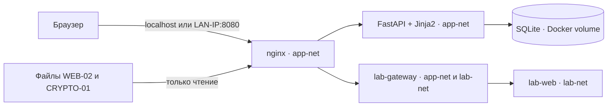

# Приёмка CYBERARENA по учебному кейсу Школы 21

Основание: «Кейс Школа 21.pdf» — границы проекта, задания, инфраструктура,
приёмка и комплект сдачи. Цель — локальный мини-турнир для 5–10 участников.
Дата демонстрации — 20 ноября 2026 года. Публикация лаборатории в интернет
не входит в MVP.

## Статус на 15 ноября 2026 года

PR #30 со скриптом запуска слит в `main`; код установщика проверен на
`fa992a8`, merge-коммит — `a46939e`. CI этого кода успешен. Есть отчёты
автора о Windows PowerShell 5.1, повторном запуске, ошибках конфигурации и
проверке ссылок. Источники и ограничения собраны в
[протоколе проверок](ctf-verification.md).

Полный проход трёх заданий на 400 баллов на целевом ноутбуке, LAN-проверка
двумя физическими устройствами и мини-турнир на 5–10 участников без интернета
по опубликованным отчётам ещё не подтверждены. Статус «готово к показу»
ставится после выполнения протокола ниже, а не по факту merge или `healthy`.

## Что именно сдаём

- FastAPI с серверными HTML-шаблонами, авторизацией и SQLite в Docker volume.
- Четыре сервиса: `app`, `nginx`, `lab-gateway`, `lab-web`.
  Gateway ограничивает связь лаборатории с платформой и не является заданием.
- WEB-01 — контейнерная лаборатория, 100 баллов; WEB-02 — HTML/JS, 150 баллов;
  CRYPTO-01 — текстовый файл, 150 баллов. Максимум за три задания — 400.
- Регистрация, профиль, каталог, отправка флагов, история, рейтинг и админка.
- На Windows `start.bat` создаёт отсутствующий `.env`, запускает стек,
  проверяет материалы и настраивает нетронутые карточки. Режим `-NoBuild`
  запускает заранее собранные образы без сборки и pull.
- Авторские решения находятся вне nginx mount. Репозиторий публичный:
  недоступность write-up через `/files/` не скрывает его в GitHub.
  Для соревнования с неизвестными заданиями нужны отдельные материалы.

По умолчанию адрес — `http://localhost:8080`; для LAN задайте в `.env`
фактический локальный IP через `NGINX_BIND` и используйте его на всех
устройствах, включая сам ноутбук. HTTPS, публичный сайт и GitHub ruleset
не входят в локальную приёмку MVP.

## Схема локального стенда

У `lab-web` нет ребра к `app`, SQLite или Docker Socket. Через gateway разрешён
только фиксированный маршрут учебной лаборатории.

## Подготовка демонстрационного ноутбука

1. На чистой Windows установите Git и Docker Desktop, откройте новое окно
   PowerShell, проверьте `git --version`, `docker compose version` и
   `docker info`. Получите репозиторий по [README](../README.md).
2. Пока есть интернет, выполните `.\start.bat` из корня checkout.
   Не создавайте `.env` из шаблона перед автоматической установкой:
   отсутствующий файл скрипт заполнит сам. При ручном пути подготовьте
   секреты и карточки по README. Сохраните коммит: `git rev-parse HEAD`.
3. Убедитесь, что все четыре сервиса healthy и каталог участника содержит
   три задания. Используйте подсказку установщика о пароле; новый
   администратор должен сменить начальный пароль.
4. Сохраните резервную копию SQLite и защищённую копию `.env`.
   Не меняйте имя Compose-проекта при повторном запуске и восстановлении.
   Не применяйте `-ResetData` или `down -v` к нужной базе.
5. Отключите внешний интернет, сохранив локальную сеть. Выполните
   `.\start.bat -NoBuild` и повторите путь участника. Если нужных образов
   нет, подготовьте их заранее; не подменяйте этот результат онлайн-прогоном.
6. Зафиксируйте `docker stats --no-stream`. Ориентир кейса — 1–1,5 ГБ RAM
   для проекта на ноутбуке с 8 ГБ RAM, 4 логическими CPU и 10 ГБ свободного
   диска. Замер другого стенда не подтверждает этот пункт.

### Перенос подготовленных образов

На машине с интернетом: `docker save -o cyberarena-images.tar nginx:stable-alpine cyberarena-app:dev cyberarena-lab-web:dev`.
На целевой машине: `docker load -i cyberarena-images.tar`, затем
`.\start.bat -NoBuild`. Архитектура процессора должна совпадать.

Отдельно перенесите checkout нужного коммита с `compose.yaml`, `nginx/`,
`files/` и установщиком. Образы не содержат этот bind mount и не переносят
SQLite volume. Для существующей установки восстановите проверенную резервную
копию и прежний `.env`; для новой установки скрипт создаст настройки.
Если образы переименованы через Compose override, используйте их фактические имена.

## Публикация заданий

`start.bat` сверяет настоящие материалы через nginx до настройки карточек.
Нетронутыми считаются черновики с ревизией 1, пустым флагом и исходными
полями. Установщик вычисляет флаги WEB-02/CRYPTO-01 из материалов, а для WEB-01
берёт эффективное значение лаборатории из Compose. После настройки
он открывает ссылки опубликованных карточек через nginx.

Изменённые карточки не перезаписываются. Несовпадающий флаг, скрытый
изменённый черновик или недоступная ссылка дают ошибку без «Готово».
Исправьте их в `/admin` и повторите установку. Часть других карточек
к этому моменту уже может быть опубликована.

При ручной установке создайте черновики в `/admin`, заполните поля по
[WEB-02](WEB-02-publish.md), [CRYPTO-01](CRYPTO-01-publish.md) и
[WEB-01](WEB-01-writeup.md), затем опубликуйте после проверки ресурсов.
Не меняйте флаг опубликованного задания без оценки существующих решений.
Файлы в `files/` доступны независимо от публикации карточки.

HTTP 200, настроенный хеш и сообщение «Готово» не проверяют весь путь решения.
На целевом стенде участник должен извлечь настоящие флаги и успешно сдать их.

## Протокол приёмки на демонстрационном ноутбуке

| Проверка | Наблюдаемый результат |
| --- | --- |
| Чистый запуск по README | Без скрытых ручных шагов: создан .env, четыре сервиса healthy, три карточки опубликованы; адрес соответствует localhost или выбранному LAN-IP |
| Администратор | Входит по подсказке установщика, меняет начальный пароль, редактирует, скрывает и публикует карточку |
| Каталог | Два обычных участника видят только опубликованные задания с названием, категорией, сложностью, баллами и состоянием решения |
| Все три задания | Один пробный участник проходит WEB-01, WEB-02 и CRYPTO-01 по настоящим ресурсам, получает 100/150/150 и итоговые 400 баллов |
| Отправки и рейтинг | Каждый из двух участников решает минимум одно задание; неверная и повторная отправки не дают баллов; при равенстве решает время последнего успешного решения |
| Ресурсы | Ссылки карточек открываются в браузере; WEB-02 работает с DevTools; CRYPTO-01 скачивается; секреты и write-up не раздаются nginx |
| Изоляция | lab-web без Docker Socket, тома базы, прямого доступа к app и исходящего интернета |
| Повтор и перезапуск | Повторный start.bat и docker compose restart сохраняют пользователей, карточки, решения и 400 баллов контрольного участника |
| Офлайн | После отключения интернета start.bat -NoBuild запускает подготовленный стек; вход и решения продолжают работать |
| Отказ лаборатории | На отдельной репетиции остановка lab-web даёт понятную ошибку лаборатории, платформа и рейтинг работают; затем лаборатория возвращена |
| LAN | Два физических устройства одной доверенной сети регистрируются, входят, решают задания и видят рейтинг без внешнего интернета |
| Мини-турнир | 5–10 одновременных участников проходят сценарий без сбоев; RAM/CPU измерены на целевом ноутбуке |
| Восстановление | Есть читаемая резервная копия SQLite и защищённый .env; восстановление проверено на отдельном стенде |

Для каждой строки запишите дату, коммит, проверявшего и фактический результат.
Не включайте пароли и флаги в отчёт. Для LAN разрешите TCP 8080 только
доверенной подсети; HTTP не шифрует пароли, используйте временные турнирные
учётные данные. Порты `app`, SQLite и `lab-web` наружу не публикуются.

Негативные проверки потери `.env`, несовпадения флага, занятого тома и
`-ResetData` проводите только с отдельным checkout/проектом и ненужными данными.

## Команды эксплуатации

| Действие | Команда |
| --- | --- |
| Первый запуск и сборка на Windows | `start.bat` |
| Без интернета после подготовки образов | `start.bat -NoBuild` |
| Состояние | `docker compose ps --all` |
| Логи | `docker compose logs --tail=100` |
| Снимок SQLite | `bash scripts/backup-db.sh` для выбранного Compose-проекта |
| Остановка с сохранением данных | `docker compose down` |
| Сброс только результатов | В /admin с подтверждением RESET DEMO RESULTS |
| Полная переустановка Windows | `start.bat -ResetData`, только после копии нужных данных |
| Ручной полный сброс | `bash scripts/reset-data.sh`, только после копии нужных данных |

Bash-скрипты запускаются из WSL или Git Bash, а не как команды PowerShell.
Bash-скрипты используют текущую конфигурацию Compose. Перед их применением
сверьте имя проекта и тома с установщиком, особенно при COMPOSE_PROJECT_NAME
или override-файлах; сохраняйте прежнюю конфигурацию при восстановлении.
