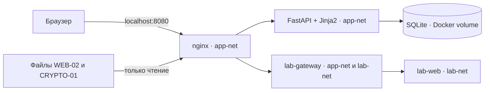

# Приёмка CYBERARENA по учебному кейсу Школы 21

Основание: «Кейс Школа 21.pdf» — границы проекта, задания, инфраструктура, приёмка и комплект сдачи. Цель — мини-турнир для 5–10 участников на одном ноутбуке. Рабочий адрес — `http://localhost:8080`; публикация лаборатории в интернет не входит в MVP.

## Что именно сдаём

- Одно приложение FastAPI с серверными HTML-шаблонами и SQLite в Docker volume.
- Nginx на `127.0.0.1:8080` и один **уязвимый учебный сервис** `lab-web` для WEB-01. Дополнительный `lab-gateway` ограничивает связь лаборатории с платформой; он не является вторым заданием.
- Три задания: WEB-01 (100 баллов, контейнер), WEB-02 (150 баллов, статические HTML/JS), CRYPTO-01 (150 баллов, текстовый файл). По кейсу WEB-02 допускает анализ исходного JavaScript или HTTP-ответа: извлечение токена из публичного JS само по себе не нарушает ТЗ.
- Регистрация, профиль, каталог, отправка флагов, рейтинг и админка с публикацией и сбросом результатов.
- Отдельные авторские решения в `docs/`. Они не должны отдаваться через `/files/`; участникам нельзя выдавать доступ к репозиторию с этими файлами до окончания турнира.

HTTPS для публичного сайта, защита ветки GitHub и облачная инфраструктура не входят в локальную приёмку. Не откладывайте из-за них обязательный сценарий.

## Схема локального стенда

У `lab-web` нет ребра к `app`, SQLite или Docker Socket. Через gateway разрешён
только фиксированный маршрут учебной лаборатории.

## Подготовка демонстрационного ноутбука

1. Установите Docker с Compose и подготовьте `.env` по [README](../README.md). Сохраните действующие `.env`, `SESSION_SECRET` и том SQLite при обновлении. Не выводите секреты в отчёты или логи.
2. Пока интернет доступен, соберите и запустите стек командой `docker compose up -d --build`. Проверьте `docker compose ps --all`: `app`, `nginx`, `lab-gateway`, `lab-web` должны стать healthy.
3. До турнира выполните `bash scripts/backup-db.sh` из корня проекта и проверьте читаемость полученной копии SQLite. Для Windows используйте Bash в WSL или Git Bash. Не используйте `down -v` при обновлении.
4. Проведите отдельную репетицию **без интернета** на том же ноутбуке после подготовки образов. Проверьте запуск стека и полный цикл участника. Если `--build` пытается обратиться к сети, используйте заранее собранные образы и `docker compose up -d --no-build`; зафиксируйте этот способ в инструкции для конкретного ноутбука. Зелёный облачный CI не заменяет такую проверку.
5. Измерьте спокойное потребление RAM/CPU командой `docker stats --no-stream` и сохраните результат. Ориентир кейса — не более 1–1,5 ГБ RAM для проекта на ноутбуке с 8 ГБ RAM, 4 логическими CPU и 10 ГБ свободного диска.

## Публикация заданий

Проверка файлов должна предшествовать публикации карточек: `/lab/` для WEB-01, `/files/web-02/` для WEB-02, `/files/crypto-01/challenge.txt` для CRYPTO-01. Входящие в репозиторий файлы становятся доступны через nginx до публикации карточки.

Администратор создаёт или обновляет три карточки через `/admin` (кнопка добавления черновиков), устанавливает серверные флаги и публикует только после проверки материалов и полного пути решения. Используйте инструкции [WEB-02](WEB-02-publish.md) и [CRYPTO-01](CRYPTO-01-publish.md). Сверьте, что флаги принимаются именно на демонстрационном стенде; тестовый CI сам задаёт свои флаги и этого не доказывает. Не меняйте флаг уже настроенного задания без оценки существующих решений.

## Протокол приёмки на демонстрационном ноутбуке

| Проверка | Наблюдаемый результат |
| --- | --- |
| Чистый запуск по README | Платформа доступна на `localhost:8080`, все четыре служебных контейнера healthy; дополнительных API, облака или интернета не требуется. |
| Администратор | Меняет начальный пароль, редактирует карточку, скрывает и публикует её; участник видит только опубликованные задания. |
| Каталог | Два обычных участника регистрируются и видят все три задания с названием, категорией, сложностью, баллами и статусом решения. |
| Решения | Каждый из двух участников решает минимум одно задание. Неверный флаг не даёт баллов, первый верный даёт стоимость задания, повторный не начисляет повторно. |
| Рейтинг | Участники упорядочены по баллам, при равенстве — по времени последнего результативного решения. |
| Ресурсы | WEB-01 открывается через `/lab/`; WEB-02 и CRYPTO-01 доступны по ссылкам карточек; write-up и секреты платформы не раздаются через `/files/`. |
| Изоляция | `lab-web` не имеет Docker Socket, тома SQLite, прямого доступа к `app` или исходящего интернета. |
| Перезапуск | После `docker compose restart` пользователи, опубликованные карточки и результаты сохраняются. |
| Отказ лаборатории | При остановке только `lab-web` лаборатория показывает понятную ошибку; страницы платформы и рейтинг продолжают работать. После проверки лабораторию снова запускают. |
| Мини-турнир | 5–10 локальных участников проходят сквозной сценарий без сбоев; RAM/CPU измерены на целевом ноутбуке. |

Для каждой строки сохраните дату, версию Git, фактический результат и имя проверявшего. Статус **готово** ставится только после полного прогона на целевом ноутбуке. Проверка CI на порту 18080 доказывает работоспособность тестовой сборки, но не публикацию и настройку стенда 8080.

## Команды эксплуатации

| Действие | Команда |
| --- | --- |
| Запуск после подготовки `.env` | `docker compose up -d --build` |
| Состояние | `docker compose ps --all` |
| Логи | `docker compose logs --tail=100` |
| Снимок SQLite | `bash scripts/backup-db.sh` |
| Остановка с сохранением данных | `docker compose down` |
| Сброс только результатов | Через `/admin` с подтверждением `RESET DEMO RESULTS` |
| Полный сброс всех демонстрационных данных | `bash scripts/reset-data.sh`, только после сохранения нужной копии |

`scripts/reset-data.sh` удаляет том SQLite вместе с пользователями, заданиями и результатами. Команды резервного копирования и полного сброса требуют Bash; они не являются командами PowerShell.
